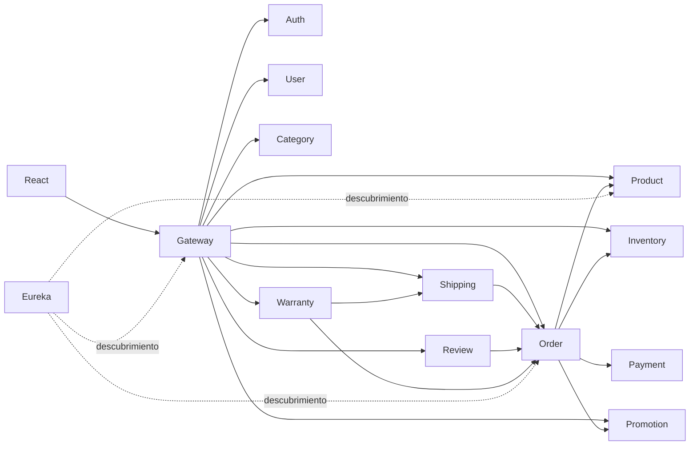

# Documento de integracion EP3 (borrador)

| Vista | Endpoint principal | Identidad |
|---|---|---|
| Catalogo y producto | GET /api/v1/products, /api/v1/categories, /api/v1/reviews/product/{id} | Publico |
| Registro y login | POST /api/v1/auth/register, /api/v1/auth/login | Publico |
| Perfil | GET /api/v1/users/me | JWT |
| Carrito | POST /api/v1/promotions/preview | Publico |
| Checkout | POST /api/v1/orders; POST /api/v1/orders/{id}/payment | CLIENTE; Idempotency-Key en creacion |
| Mis ordenes | GET /api/v1/orders/me; POST /api/v1/reviews; /api/v1/warranties/me | CLIENTE |
| Operador | /api/v1/orders/operator, /api/v1/shippings, /api/v1/inventory/adjustments/{id} | OPERADOR o ADMINISTRADOR; Idempotency-Key en ajuste |
| Administrador | /api/v1/products, /api/v1/categories, /api/v1/promotions, /api/v1/reviews | ADMINISTRADOR para gestion |

Auth valida BCrypt y cuenta activa y firma JWT HS256 con sujeto del perfil, rol y expiracion. React envia Bearer al Gateway; las rutas privadas validan firma y rol, y los servicios con seguridad propia verifican el token. Nunca tomar un ID enviado por el cliente como identidad. Los secretos de comunicacion interna deben coincidir entre los pares respectivos.

La interfaz debe distinguir 400 (datos), 401 (sesion), 403 (rol), 404 (recurso), 409 (conflicto o stock) y 503 (servicio temporalmente indisponible). Los reintentos de checkout y ajustes reutilizan su clave. Anulacion utiliza estados recuperables; ordenes antiguas con despacho no verificado quedan bloqueadas para anular. Garantia demo: 180 dias calendario desde entrega confirmada.

Swagger de Order se verific? en http://localhost:19647/doc/swagger-ui.html: esquema Bearer, Idempotency-Key y respuestas 201, 400, 401, 403, 409 y 503 en la creaci?n. Captura: [Swagger de ?rdenes](evidencia/swagger-order.png). La verificaci?n completa de Swagger de los dem?s servicios y los recorridos integrales por rol siguen pendientes. Las rutas internas no deben publicarse por Gateway.
